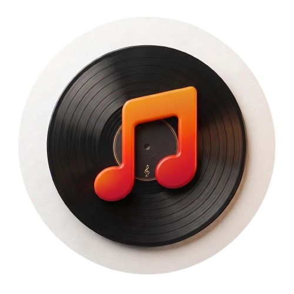

<div align="center">



# 🌌 Aurora Media Player (Universal Edition)
### **Next-Gen Liquid-Glass Audio & Video Player with 20-Band Studio Equalizer, All-Codec Engine & 0.1% Video Stretch Studio**

[](https://github.com/avinashnewdev/MEDIA-PLAYER-AURORA/releases/latest)
[](https://github.com/avinashnewdev/MEDIA-PLAYER-AURORA/releases)
[](https://avinashnewdev.github.io/MEDIA-PLAYER-AURORA/)
[](https://github.com/avinashnewdev/MEDIA-PLAYER-AURORA)

<p align="center">
  <b>Experience cinema-grade video playback and audiophile sound processing across Windows PC, Android, and iOS — 100% Free, Ad-Free, and Offline.</b>
</p>

[⬇️ **Download for Windows (.EXE)**](https://github.com/avinashnewdev/MEDIA-PLAYER-AURORA/releases/latest) · [📱 **Download for Android (.APK)**](https://github.com/avinashnewdev/MEDIA-PLAYER-AURORA/releases/latest) · [🍎 **Install on iOS (.IPA / PWA)**](#-3-ios-iphone--ipad-installation) · [🌐 **Launch Web Player**](https://avinashnewdev.github.io/MEDIA-PLAYER-AURORA/)

</div>

---

## 📥 How to Install (Apne Device Ke Hisab Se Install Karein)

Naye users bina kisi coding ya setup ke sidha apne device par **Aurora Media Player** install kar sakte hain:

### 💻 1. Windows PC / Laptop (`.EXE`)
1. Is repository ke [**Releases**](https://github.com/avinashnewdev/MEDIA-PLAYER-AURORA/releases/latest) page par jayein.
2. **`Aurora-Media-Player.exe`** (Portable ya Installer) file download karein.
3. Double-click karke run karein. *(Note: Agar Windows SmartScreen popup aaye, toh **"More Info" -> "Run Anyway"** par click karein).*

---

### 🤖 2. Android Phone / Tablet / Android TV (`.APK`)
1. [**Releases**](https://github.com/avinashnewdev/MEDIA-PLAYER-AURORA/releases/latest) section se **`Aurora-Media-Player.apk`** download karein.
2. APK file par tap karein aur **"Install from Unknown Sources"** allow karein.
3. App open karein aur **"Add File"** ya **"Add Folder"** daba kar apne phone ke sabhi songs aur movies load karein!

---

### 🍎 3. iOS (iPhone & iPad) Installation
iPhone aur iPad users do tariko se bilkul **FREE** me install kar sakte hain:

* **Method A: Instant Native Fullscreen App (No PC Required — Recommended)**
  1. Apne iPhone/iPad ke **Safari Browser** me ye link kholein:  
     👉 **`https://avinashnewdev.github.io/MEDIA-PLAYER-AURORA/`**
  2. Niche बीच (center) me **Share Button** (`⬆️`) par tap karein.
  3. Scroll down karke **"Add to Home Screen"** daba dein.
  4. Ab Aurora aapke iPhone ke Home Screen par ek 100% Native Offline App ki tarah aa jayega!

* **Method B: Direct `.IPA` Sideloading**
  1. [**Releases**](https://github.com/avinashnewdev/MEDIA-PLAYER-AURORA/releases/latest) page se **`Aurora-Media-Player-iOS.ipa`** download karein.
  2. **AltStore**, **SideStore**, ya **Sideloadly** ki madad se apne iPhone me install kar lein.

---

## ✨ Key Features (Is Player Me Kya-Kya Hai?)

### 🎬 1. Universal All-Codec Video & Audio Engine
* **All Video Formats Supported:** `.mp4`, `.mkv`, `.webm`, `.avi`, `.mov`, `.flv`, `.wmv`, `.ts`, `.m4v`, `.3gp`, `.mpg`, `.ogv`, aur `.m3u8` (HLS Streams).
* **All Audio Formats Supported:** `.mp3`, `.flac`, `.wav`, `.m4a`, `.aac`, `.ogg`, `.opus`, `.wma`, `.ac3`, `.eac3`, `.dts`, `.mka`, `.aiff`.
* **Smart H.265 / HEVC & Matroska (MKV) Demuxer:** Zero-copy header patching ke saath heavy HEVC (`hev1` / `hvc1`) aur multi-track MKV movies bina ruke play hoti hain.

### 🎚️ 2. 20-Band Studio Equalizer & Live Spectrum Visualizer
* **20 Precision Frequency Bands:** `20Hz` sub-bass se lekar `20kHz` air-treble tak (`±12 dB` range + Preamp control).
* **Interactive Custom EQ Graph:** Graph ke upar direct mouse ya finger drag karke apna custom sound curve banayein.
* **Built-In + Custom User Presets:** *Flat, Bass Boost, Vocal, Rock, Pop, Classical, Night Mode* — aur apna khud ka preset naam dekar save karne ka option.
* **Dedicated Audio Processing:** Separate **Sub-Bass Boost (65Hz)**, **Left/Right Stereo Balance**, **Smooth Crossfade**, **Gapless Playback**, aur **Pitch Lock** (0.5x se 2x speed par bhi singer ki aawaz natural rehti hai).

### 🔊 3. Multi-Audio Track Switcher & 300% Cinema Booster
* **Dual / Multi-Audio Support:** Movies me **Track 1 / Track 2** (e.g., Hindi / English / Original) ek click me switch karein ya bahar se `.mp3/.m4a` dub track load karein.
* **5.1 / 7.1 Surround Downmix Normalizer:** 6-channel movie audio ke center dialogue channel ko automatically Left+Right stereo me clear mix karta hai.
* **Advanced Sound Modes:**
  * 🔥 **Audio Boost 200% & 300% Cinema Max** (Dynamics Compressor ke saath)
  * 🎙️ **Dialogue Voice Enhancer**
  * 🎧 **Dual-Audio Split** (Left channel to both ears / Right channel to both ears)
  * 🎤 **Vocal Cut / Karaoke Mode** & **Reverse Stereo**

### 📐 4. 0.1% Precision Video Zoom & 4-Side Edge Stretch Studio
* **Quick Aspect Ratio Modes:** *Best Fit, Fill / Crop (Remove Black Bars), Full Stretch, 16:9 Widescreen, 21:9 Cinema*.
* **4-Side Independent Edge Control:** Video ke **Top, Bottom, Left, aur Right** edges ko alag-alag `0.1%` ki bariki se stretch ya crop karein.
* **Custom Zoom:** `50.0%` se lekar `300.0%` tak smooth zoom slider aur stepper buttons (`+` / `-`).

### 🖐️ 5. Butter-Smooth 60/120FPS Touch Gestures (MX / VLC Style)
* **Right Side Swipe (Up / Down):** Smooth Volume Control with live percentage HUD.
* **Left Side Swipe (Up / Down):** Smooth Brightness Control (`20%` Dim Scrim se `180%` Boost tak).
* **Horizontal Swipe (Left / Right):** Instant Video/Audio Seek forward & backward.
* **Wide Hit-Zone Sliders:** Mini-player aur Now Playing me bina atke chalne wale liquid-glass waveform scrubbers.

### 🖼️ 6. Universal Picture-in-Picture (PiP) & Lyrics / Subtitles
* **Video + Audio Floating PiP:** Video ke saath-saath Audio songs ke liye bhi live animated waveform wala **Floating Mini-PiP Window** jo har platform par kaam karta hai.
* **Subtitles & Synced Lyrics:** `.srt`, `.vtt`, aur `.lrc` files support—गाने के साथ अपने-आप स्क्रॉल होने वाले लिरिक्स।

### 👤 7. 100% Offline Multi-User Profiles & Smart Library
* **Isolated User Profiles:** Ek hi device par alag-alag users apna profile (Photo + Name) bana sakte hain. Har user ki **Playlists, EQ Presets, Favourite Songs, Theme, aur Watch History** bilkul alag (isolated) rehti hai!
* **Smart Metadata & Cover Art Extractor:** MP3 (ID3), FLAC, aur MP4 se original Album Art nikalta hai, aur video ke dark frames ko skip karke smart HD thumbnail banata hai.
* **Drag-and-Drop Playlists:** Playlist ko `M3U / M3U8 / JSON` me import ya export karein, custom cover photo lagayein, aur tracks ko drag-and-drop (`⋮⋮`) se arrange karein.

### 🎨 8. Custom Liquid-Glass UI & Themes
* **Apple-Inspired Liquid Glass Design:** Interactive sliding glass lens navigation bar, dynamic music-reactive Aurora background canvas, aur curved corner Light/Dark arc toggle.
* **Full Customization:** *Stargirl, Aurora, Ocean, Sunset, Rose, Forest, Neon* presets + **Custom Color Picker Studio** + **Custom Wallpaper Image** support.

---

## ⌨️ Keyboard & Mouse Shortcuts (For PC Users)

| Shortcut / Action | Function |
| :--- | :--- |
| **`Spacebar`** | Play / Pause |
| **`Right Arrow (→)` / `Left Arrow (←)`** | Seek Forward `+5s` / Backward `-5s` |
| **`Up Arrow (↑)` / `Down Arrow (↓)`** | Volume Up `+5%` / Down `-5%` |
| **`Ctrl + ↑` / `Ctrl + ↓`** | Precision Volume Control with HUD |
| **`Mouse Wheel Scroll` (On Video)** | Smooth Volume Up / Down |
| **`E` / `G`** | Brightness Increase (`+5%`) / Decrease (`-5%`) |
| **`M`** | Mute / Unmute Audio |
| **`F`** | Toggle Fullscreen Mode |
| **`N` / `P`** | Next Track / Previous Track |
| **`/` (Forward Slash)** | Jump to Master Search Bar |

---

## 🛠️ For Developers (Run or Build Locally)

Agar aap is project ko apne computer par modify ya build karna chahte hain:

```bash
# 1. Clone the repository
git clone [https://github.com/avinashnewdev/MEDIA-PLAYER-AURORA.git](https://github.com/avinashnewdev/MEDIA-PLAYER-AURORA.git)
cd MEDIA-PLAYER-AURORA

# 2. Install dependencies
npm install

# 3. Run Desktop App in Development Mode
npm start

# 4. Build Windows (.EXE) Portable & Installer
npm run build:win
